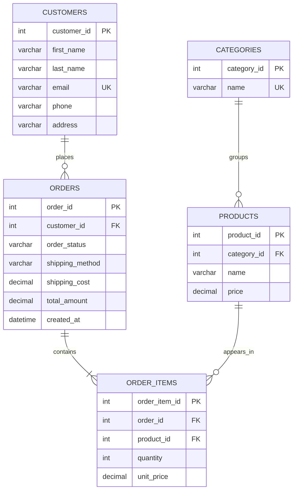

# E-commerce order database

`unit_price` records the product price when the order was placed, so a later catalog price change does not alter a past order. `total_amount` stores the checkout total, including shipping.
